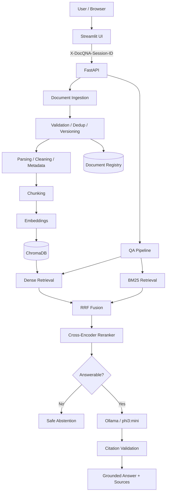

# DocQ&A

> An evaluation-first Retrieval-Augmented Generation (RAG) system for grounded question answering over PDF, DOCX, and TXT documents.

DocQ&A is a production-oriented document question-answering project built around measurable retrieval quality, grounded generation, citation validation, document lifecycle management, persistence, and anonymous session isolation.

It is intentionally more than a basic “chat with PDF” demo: the project compares retrieval and chunking choices experimentally, uses hybrid retrieval with reranking, can abstain when evidence is insufficient, preserves source metadata for traceable answers, and packages the validated application as a Docker Compose stack.

**Deployment status:** the local Docker stack has passed end-to-end and persistence validation. Public cloud deployment and HTTPS are the next deployment steps.

---

## Current capabilities

- PDF, DOCX, and TXT ingestion
- document validation, deduplication, and versioning
- cleaning, normalization, structure detection, and metadata extraction
- fixed, structure-aware, and semantic chunking implementations
- SentenceTransformers embeddings
- persistent ChromaDB vector storage
- BM25 lexical retrieval
- dense + BM25 hybrid retrieval
- Reciprocal Rank Fusion (RRF)
- cross-encoder reranking
- metadata/document filtering
- answerability threshold and exact safe abstention
- grounded Ollama generation with `phi3:mini`
- citation normalization, repair, and validation
- FastAPI backend
- Streamlit UI
- anonymous per-session document isolation
- browser-refresh session continuity
- request/latency logging and reliability tests
- evaluation datasets, experiment runners, and saved experiment artifacts
- Docker / Docker Compose packaging with persistent volumes
- 20 MB upload-size enforcement

---

## Production RAG configuration

| Component | Configuration |
|---|---|
| Chunking | Fixed, 200 words, 40-word overlap |
| Embeddings | `sentence-transformers/all-MiniLM-L6-v2` |
| Embedding device | CPU |
| Vector store | ChromaDB, cosine |
| Lexical retrieval | BM25 |
| Fusion | RRF, `k=60` |
| Candidate pool | 10 |
| Reranker | `cross-encoder/ms-marco-MiniLM-L-6-v2` |
| Reranker candidates | 20 |
| Final context | Top 5 chunks |
| Answerability threshold | Rank-1 CE score `>= 0` |
| LLM | Ollama `phi3:mini` |
| Generation | temperature `0`, `num_predict=320` |

Unsupported questions return exactly:

```text
The provided documents do not contain enough information to answer the question.
```

These production values are frozen from the evaluation work and should change only when new evaluation evidence justifies a change.

---

## Architecture



See [`docs/architecture.md`](docs/architecture.md) for the detailed system design.

---

## Evaluation highlights

The final evaluation set contains 30 labeled questions: 18 answerable and 12 unanswerable.

| Retriever | Hit@1 | Hit@3 | Hit@5 | MRR | Page Recall |
|---|---:|---:|---:|---:|---:|
| Dense | 0.6667 | 0.8889 | 1.0000 | 0.7963 | 0.9444 |
| BM25 | 0.7778 | 1.0000 | 1.0000 | 0.8889 | 0.9444 |
| RRF | 0.7222 | 1.0000 | 1.0000 | 0.8519 | 0.9444 |
| RRF + Cross-Encoder | **0.8333** | **1.0000** | **1.0000** | **0.9074** | **1.0000** |

BM25 measured a slightly higher nDCG (`~0.9067`) than the RRF + cross-encoder configuration (`~0.9050`), so the project does not claim that reranking wins every metric.

Final analysis artifacts are stored under:

```text
data/evaluation/results/phase22g_final_analysis/
```

See [`docs/evaluation.md`](docs/evaluation.md).

---

## Anonymous session isolation

The application uses a high-entropy anonymous session identifier sent to the API as:

```text
X-DocQNA-Session-ID
```

On first use, Streamlit generates a UUID4-based session ID and persists it in the browser as `docqna_session_id`. On page refresh, the same valid browser cookie is reused so the browser remains in the same anonymous document namespace.

The backend owns and enforces session scope across document registration, deduplication/versioning, Chroma metadata filtering, BM25 filtering, QA retrieval, listing, and deletion.

This is **session isolation, not authentication**. A different browser profile or incognito session receives a different anonymous namespace, and there is no account recovery or cross-device identity.

---

## Repository structure

```text
docqna/
├── .dockerignore
├── .env.example
├── .gitattributes
├── .gitignore
├── README.md
├── SECURITY.md
├── docker-compose.yml
├── Dockerfile.api
├── Dockerfile.streamlit
├── pyproject.toml
├── requirements.txt
├── requirements-dev.txt
│
├── src/
│   └── docqna/
│       ├── api/
│       ├── embeddings/
│       ├── evaluation/
│       ├── generation/
│       ├── indexing/
│       ├── ingestion/
│       ├── rag/
│       ├── retrieval/
│       ├── ui/
│       ├── constants.py
│       ├── exceptions.py
│       ├── filters.py
│       ├── logging_config.py
│       └── settings.py
│
├── data/
│   └── evaluation/
│       ├── baseline_questions.json
│       ├── evaluation_dataset_v2.json
│       ├── unanswerable_questions.json
│       └── results/
│
├── docs/
│   ├── architecture.md
│   ├── evaluation.md
│   └── limitations.md
│
├── run_*.py
└── test_*.py
```

Generated runtime indexes, document metadata, logs, local sample documents, secrets, and virtual environments are intentionally excluded from Git.

---

## Requirements

### Docker path

- Docker Engine / Docker Desktop
- Docker Compose

The Docker stack provides FastAPI, Streamlit, and Ollama. The configured Ollama model is pulled into a persistent Docker volume by the one-shot initialization service.

### Local Python path

- Python 3.11
- Ollama
- `phi3:mini`

---

## Local setup

```bash
git clone https://github.com/Md-Faiz-Alam/docqna.git
cd docqna
python -m venv .venv
```

Windows:

```powershell
.venv\Scripts\Activate.ps1
```

Linux/macOS:

```bash
source .venv/bin/activate
```

Install runtime dependencies and the local package:

```bash
pip install -r requirements.txt
pip install -e . --no-deps
```

Development/testing dependencies:

```bash
pip install -r requirements-dev.txt
```

---

## Configure local runtime

Pull the Ollama model:

```bash
ollama pull phi3:mini
```

Create `.env` from `.env.example`.

Typical local values:

```env
APP_ENV=development
APP_HOST=0.0.0.0
APP_PORT=8000

LLM_PROVIDER=ollama
OLLAMA_BASE_URL=http://127.0.0.1:11434
OLLAMA_MODEL=phi3:mini

EMBEDDING_MODEL=sentence-transformers/all-MiniLM-L6-v2
EMBEDDING_DEVICE=cpu
EMBEDDING_BATCH_SIZE=32

MAX_UPLOAD_SIZE_MB=20
LOG_LEVEL=INFO
```

---

## Run locally

FastAPI:

```bash
uvicorn docqna.api.main:app --reload --host 0.0.0.0 --port 8000
```

Streamlit:

```bash
streamlit run src/docqna/ui/streamlit_app.py
```

The local Streamlit UI uses `http://127.0.0.1:8000` as the API fallback unless `DOCQNA_API_URL` is supplied by the environment.

---

## API surface

```text
GET    /health
POST   /qa
POST   /documents
GET    /documents
DELETE /documents/{document_id}
```

Document and QA operations require the anonymous session header enforced by the backend.

---

## Run with Docker

Build and start the complete stack:

```bash
docker compose up -d --build
```

Check service state:

```bash
docker compose ps
```

Local endpoints:

```text
Streamlit: http://localhost:8501
FastAPI:   http://127.0.0.1:8000
Health:    http://127.0.0.1:8000/health
```

The Compose topology intentionally keeps FastAPI bound to the Docker host loopback address while Streamlit is published on port `8501`. Ollama is reachable by the API over the internal Compose network.

The Docker stack uses persistent named volumes for:

```text
ollama_data
docqna_indexes
docqna_metadata
huggingface_cache
```

This preserves the Ollama model, Chroma index, document registry, and downloaded Hugging Face models across container recreation.

Stop the stack without deleting data:

```bash
docker compose down
```

Do **not** use `docker compose down -v` unless you intentionally want to delete the named volumes and their persisted data.

The first document upload or first QA request can be slower because the embedding and cross-encoder models may need to download into the persistent Hugging Face cache.

---

## Validated Docker behavior

The local containerized stack has been validated for:

- healthy Ollama, FastAPI, and Streamlit services
- PDF upload and indexing
- grounded answers with citations
- exact abstention for an unrelated question
- Chroma and registry persistence across API-container recreation
- browser-refresh continuity for the same anonymous session
- QA after API-container recreation without re-uploading the document

These checks validate local packaging and persistence. They do not represent a large-scale load test or a completed public cloud deployment.

---

## Tests

Run the full test suite:

```bash
python -m pytest -q
```

Critical reliability checks:

```bash
python -m pytest -q test_rag_prompt_hardening.py test_rag_reliability_hardening.py test_session_isolation.py
```

Product UI/session checks used during deployment hardening can also be run directly when present:

```bash
python test_streamlit_product_ui.py
python test_session_isolation.py
```

---

## Security model

Uploaded document contents are treated as untrusted data, not system instructions.

The RAG pipeline includes prompt hardening, response sanitization, citation normalization/validation, safe abstention, anonymous session scoping, and backend upload-size enforcement. Secrets belong in `.env` and must not be committed.

See [`SECURITY.md`](SECURITY.md).

---

## Known limitations

- scanned/image-only PDFs are not supported because OCR is not implemented
- anonymous session isolation is not user authentication or durable cross-device identity
- `phi3:mini` can sometimes over-cite retrieved evidence
- the answerability threshold is calibrated on the project evaluation dataset
- CPU-only embedding, reranking, and local generation can introduce noticeable first-use or inference latency
- the system has not been load-tested as a large multi-user service
- the 20 MB upload cap is implemented, but rate limiting, storage quotas/cleanup, production resource limits, and persistent-volume backup policy are still pending
- local Docker deployment is validated, but public cloud hosting, reverse-proxy configuration, and HTTPS are still pending

See [`docs/limitations.md`](docs/limitations.md).

---

## Project status

Completed:

- ingestion and document lifecycle
- chunking implementations and experiments
- embeddings and Chroma persistence
- dense + BM25 retrieval
- RRF fusion
- cross-encoder reranking
- answerability/abstention
- grounded generation and citation hardening
- FastAPI + Streamlit product flow
- observability
- evaluation pipeline and experiment analysis
- anonymous session isolation
- repository cleanup
- Docker packaging
- 20 MB upload-size enforcement
- browser-refresh session persistence
- local Docker end-to-end validation
- persistent Chroma/registry validation across API-container recreation

Next:

- deploy the validated Docker stack to a remote Linux VM/server
- add reverse proxy and HTTPS for the public URL
- add rate/resource/storage controls appropriate for public traffic
- define backup/retention policy for persistent data
- final public demo and portfolio polish

---

## Project goal

The goal is not merely to “chat with a PDF.”

> Which RAG architecture works better for this document QA workload, why, and at what operational cost?

That is why retrieval quality, chunking, reranking, abstention, citations, latency, failure modes, persistence, and reproducibility are treated as measurable system decisions.
