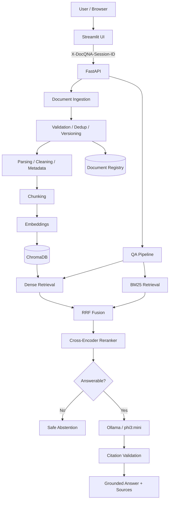

# DocQ&A

> An evaluation-first Retrieval-Augmented Generation (RAG) system for grounded question answering over PDF, DOCX, and TXT documents.

DocQ&A is a production-oriented document question-answering project built around measurable retrieval quality, grounded generation, citation validation, document lifecycle management, and anonymous session isolation.

It is intentionally more than a basic “chat with PDF” demo: the project compares retrieval and chunking choices experimentally, uses hybrid retrieval with reranking, can abstain when evidence is insufficient, and preserves source metadata for traceable answers.

## Current capabilities

- PDF, DOCX, and TXT ingestion
- document validation, deduplication, and versioning
- cleaning, normalization, structure detection, and metadata extraction
- fixed, structure-aware, and semantic chunking implementations
- SentenceTransformers embeddings
- persistent ChromaDB vector storage
- BM25 lexical retrieval
- dense + BM25 hybrid retrieval
- Reciprocal Rank Fusion (RRF)
- cross-encoder reranking
- metadata/document filtering
- answerability threshold and safe abstention
- grounded Ollama generation
- citation normalization and validation
- FastAPI backend
- Streamlit UI
- evaluation datasets, experiment runners, and saved experiment artifacts
- request/latency logging and reliability tests
- anonymous per-session document isolation

## Production RAG configuration

| Component | Configuration |
|---|---|
| Chunking | Fixed, 200 words, 40-word overlap |
| Embeddings | `sentence-transformers/all-MiniLM-L6-v2` |
| Vector store | ChromaDB, cosine |
| Lexical retrieval | BM25 |
| Fusion | RRF, `k=60` |
| Candidate pool | 10 |
| Reranker | `cross-encoder/ms-marco-MiniLM-L-6-v2` |
| Reranker candidates | 20 |
| Final context | Top 5 chunks |
| Answerability threshold | Rank-1 CE score `>= 0` |
| LLM | Ollama `phi3:mini` |
| Generation | temperature `0`, `num_predict=320` |

Unsupported questions return:

```text
The provided documents do not contain enough information to answer the question.
```

## Architecture



See [`docs/architecture.md`](docs/architecture.md) for the detailed system design.

## Evaluation highlights

The final evaluation set contains 30 labeled questions: 18 answerable and 12 unanswerable.

| Retriever | Hit@1 | Hit@3 | Hit@5 | MRR | Page Recall |
|---|---:|---:|---:|---:|---:|
| Dense | 0.6667 | 0.8889 | 1.0000 | 0.7963 | 0.9444 |
| BM25 | 0.7778 | 1.0000 | 1.0000 | 0.8889 | 0.9444 |
| RRF | 0.7222 | 1.0000 | 1.0000 | 0.8519 | 0.9444 |
| RRF + Cross-Encoder | **0.8333** | **1.0000** | **1.0000** | **0.9074** | **1.0000** |

BM25 had a slightly higher measured nDCG than the reranked system in this evaluation, so the project does not claim that reranking wins every metric.

Detailed artifacts are stored under:

```text
data/evaluation/results/
data/evaluation/results/phase22g_final_analysis/
```

See [`docs/evaluation.md`](docs/evaluation.md).

## Anonymous session isolation

The public-use application uses a high-entropy Streamlit session identifier sent as:

```text
X-DocQNA-Session-ID
```

The backend owns and enforces session scope across document lifecycle, Chroma metadata filtering, BM25 filtering, QA retrieval, listing, and deletion.

This is **session isolation, not authentication**.

## Repository structure

```text
docqna/
├── .env.example
├── .gitattributes
├── .gitignore
├── README.md
├── SECURITY.md
├── pyproject.toml
├── requirements.txt
├── requirements-dev.txt
│
├── src/
│   └── docqna/
│       ├── api/
│       ├── embeddings/
│       ├── evaluation/
│       ├── generation/
│       ├── indexing/
│       ├── ingestion/
│       ├── rag/
│       ├── retrieval/
│       ├── ui/
│       ├── constants.py
│       ├── exceptions.py
│       ├── filters.py
│       ├── logging_config.py
│       └── settings.py
│
├── data/
│   └── evaluation/
│       ├── baseline_questions.json
│       ├── evaluation_dataset_v2.json
│       ├── unanswerable_questions.json
│       └── results/
│
├── docs/
│   ├── architecture.md
│   ├── evaluation.md
│   └── limitations.md
│
├── run_*.py
└── test_*.py
```

Generated runtime indexes, document metadata, logs, local sample documents, secrets, and virtual environments are intentionally excluded from Git.

## Requirements

- Python 3.11
- Ollama
- `phi3:mini`

## Local setup

```bash
git clone https://github.com/<your-username>/docqna.git
cd docqna
python -m venv .venv
```

Windows:

```powershell
.venv\Scripts\Activate.ps1
```

Linux/macOS:

```bash
source .venv/bin/activate
```

Install:

```bash
pip install -r requirements.txt
pip install -e . --no-deps
```

Development/testing:

```bash
pip install -r requirements-dev.txt
```

## Configure Ollama

```bash
ollama pull phi3:mini
```

Create `.env` from `.env.example`.

Typical local values:

```env
APP_ENV=development
APP_HOST=0.0.0.0
APP_PORT=8000
LLM_PROVIDER=ollama
OLLAMA_BASE_URL=http://127.0.0.1:11434
OLLAMA_MODEL=phi3:mini
LOG_LEVEL=INFO
```

## Run locally

FastAPI:

```bash
uvicorn docqna.api.main:app --reload --host 0.0.0.0 --port 8000
```

Streamlit:

```bash
streamlit run src/docqna/ui/streamlit_app.py
```

Current API surfaces include:

```text
GET  /health
POST /qa
/document operations under /documents
```

## Tests

```bash
python -m pytest -q
```

Critical reliability checks:

```bash
python -m pytest     test_rag_prompt_hardening.py     test_rag_reliability_hardening.py     test_session_isolation.py     -q
```

## Security model

Uploaded document contents are treated as untrusted data, not system instructions.

The RAG pipeline includes prompt hardening, citation validation, safe abstention, and anonymous session scoping. Secrets belong in `.env` and must not be committed.

See [`SECURITY.md`](SECURITY.md).

## Known limitations

- scanned/image-only PDFs are not supported because OCR is not implemented
- anonymous session isolation is not user authentication
- the current LLM can sometimes over-cite retrieved evidence
- the answerability threshold is calibrated on the project evaluation dataset
- public deployment still needs practical rate/resource/upload/storage limits
- Docker deployment is the next implementation phase, not a completed feature yet

See [`docs/limitations.md`](docs/limitations.md).

## Roadmap

Completed:

- ingestion and document lifecycle
- chunking implementations
- embeddings and Chroma persistence
- dense + BM25 retrieval
- RRF fusion
- cross-encoder reranking
- answerability/abstention
- grounded generation and citation hardening
- FastAPI + Streamlit product flow
- observability
- evaluation pipeline and experiment analysis
- anonymous session isolation
- repository cleanup

Next:

- Docker/container deployment
- deployment hardening
- final public README/demo polish

## Project goal

The goal is not merely to “chat with a PDF.”

> Which RAG architecture works better for this document QA workload, why, and at what operational cost?

That is why retrieval quality, chunking, reranking, abstention, citations, latency, failure modes, and reproducibility are treated as measurable system decisions.
