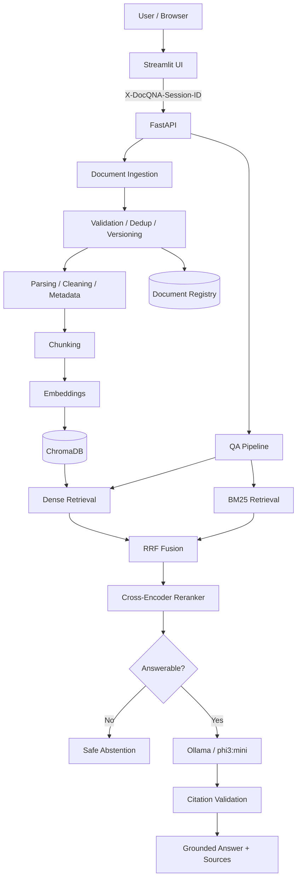

# DocQ&A

> An evaluation-first Retrieval-Augmented Generation (RAG) system for grounded question answering over PDF, DOCX, and TXT documents.

DocQ&A is a production-oriented document question-answering project built around measurable retrieval quality, grounded generation, citation validation, document lifecycle management, persistence, and anonymous session isolation.

It is intentionally more than a basic “chat with PDF” demo: the project compares retrieval and chunking choices experimentally, uses hybrid retrieval with reranking, can abstain when evidence is insufficient, preserves source metadata for traceable answers, and packages the validated application as a Docker Compose stack.

**Deployment status:** the local Docker stack has passed end-to-end and persistence validation. Public cloud deployment and HTTPS are the next deployment steps.

---

## Current capabilities

- PDF, DOCX, and TXT ingestion
- document validation, deduplication, and versioning
- cleaning, normalization, structure detection, and metadata extraction
- fixed, structure-aware, and semantic chunking implementations
- SentenceTransformers embeddings
- persistent ChromaDB vector storage
- BM25 lexical retrieval
- dense + BM25 hybrid retrieval
- Reciprocal Rank Fusion (RRF)
- cross-encoder reranking
- metadata/document filtering
- answerability threshold and exact safe abstention
- grounded Ollama generation with `phi3:mini`
- citation normalization, repair, and validation
- FastAPI backend
- Streamlit UI
- anonymous per-session document isolation
- browser-refresh session continuity
- request/latency logging and reliability tests
- evaluation datasets, experiment runners, and saved experiment artifacts
- Docker / Docker Compose packaging with persistent volumes
- 20 MB upload-size enforcement
- fixed production `top_k=5` and 2,000-character question limit
- anonymous-session document quotas and global active-document cap
- 1,000-chunk per-document cap and 24-hour anonymous-document retention
- Docker memory limits and log rotation for small-VM deployment
- pinned Ollama `0.34.1` runtime with bounded concurrency/queueing

---

## Production RAG configuration

| Component | Configuration |
|---|---|
| Chunking | Fixed, 200 words, 40-word overlap |
| Embeddings | `sentence-transformers/all-MiniLM-L6-v2` |
| Embedding device | CPU |
| Vector store | ChromaDB, cosine |
| Lexical retrieval | BM25 |
| Fusion | RRF, `k=60` |
| Candidate pool | 10 |
| Reranker | `cross-encoder/ms-marco-MiniLM-L-6-v2` |
| Reranker candidates | 20 |
| Final context | Top 5 chunks |
| Answerability threshold | Rank-1 CE score `>= 0` |
| LLM | Ollama `phi3:mini` |
| Generation | temperature `0`, `num_predict=320` |

Unsupported questions return exactly:

```text
The provided documents do not contain enough information to answer the question.
```

These production values are frozen from the evaluation work and should change only when new evaluation evidence justifies a change.

---

## Architecture



See [`docs/architecture.md`](docs/architecture.md) for the detailed system design.

---

## Evaluation highlights

The final evaluation set contains 30 labeled questions: 18 answerable and 12 unanswerable.

| Retriever | Hit@1 | Hit@3 | Hit@5 | MRR | Page Recall |
|---|---:|---:|---:|---:|---:|
| Dense | 0.6667 | 0.8889 | 1.0000 | 0.7963 | 0.9444 |
| BM25 | 0.7778 | 1.0000 | 1.0000 | 0.8889 | 0.9444 |
| RRF | 0.7222 | 1.0000 | 1.0000 | 0.8519 | 0.9444 |
| RRF + Cross-Encoder | **0.8333** | **1.0000** | **1.0000** | **0.9074** | **1.0000** |

BM25 measured a slightly higher nDCG (`~0.9067`) than the RRF + cross-encoder configuration (`~0.9050`), so the project does not claim that reranking wins every metric.

Final analysis artifacts are stored under:

```text
data/evaluation/results/phase22g_final_analysis/
```

### Public benchmark (runs in CI)

The 30-case set above uses a private document, so CI cannot run it. A second, **public** benchmark lives in [`data/evaluation/public/`](data/evaluation/public/). It contains four realistic documents for a fictional company (HR handbook, IT security policy, product warranty and cloud SLA) and 75 labelled cases: 59 paraphrased answerable questions and 16 plausible questions the documents do not answer. CI indexes it with the production retrieval stack and fails the build if quality drops below [`thresholds.json`](data/evaluation/public/thresholds.json):

| Hit@1 | Hit@3 | Hit@5 | MRR | Answerable passing the gate | Unanswerable correctly refused |
|---:|---:|---:|---:|---:|---:|
| 0.746 | 0.983 | 1.000 | 0.863 | **0.424** | 0.875 |

```bash
python -m docqna.evaluation.public_benchmark --check
```

**Known issue the benchmark exposed:** retrieval generalises well, but the production answerability threshold (cross-encoder score `>= 0`) was calibrated on one private document. On naturally phrased questions it refuses 58% of answerable questions. See [`docs/evaluation.md`](docs/evaluation.md#12-public-benchmark-and-the-answerability-gap).

See [`docs/evaluation.md`](docs/evaluation.md).

---

## Anonymous session isolation

The application uses a high-entropy anonymous session identifier sent to the API as:

```text
X-DocQNA-Session-ID
```

On first use, Streamlit generates a UUID4-based session ID and persists it in the browser as `docqna_session_id`. On page refresh, the same valid browser cookie is reused so the browser remains in the same anonymous document namespace.

The backend owns and enforces session scope across document registration, deduplication/versioning, Chroma metadata filtering, BM25 filtering, QA retrieval, listing, and deletion.

This is **session isolation, not authentication**. A different browser profile or incognito session receives a different anonymous namespace, and there is no account recovery or cross-device identity.

---

## Repository structure

```text
docqna/
├── src/docqna/              # the application package
│   ├── api/                 # FastAPI app: routes/, errors, middleware, session, DI
│   ├── ingestion/           # loaders, preprocessing, chunking, document registry
│   ├── embeddings/          # embedding model adapters
│   ├── indexing/            # Chroma vector store + document index service
│   ├── retrieval/           # dense, BM25, RRF hybrid, cross-encoder, confidence gate
│   ├── generation/          # LLM providers (Ollama)
│   ├── rag/                 # prompts + cited RAG pipeline
│   ├── evaluation/          # metrics, runners, reporting
│   ├── ui/                  # Streamlit client
│   └── settings.py          # all runtime configuration (env / .env)
├── tests/
│   ├── unit/                # fast, hermetic (fakes only) — run in CI
│   ├── integration/         # real models / Ollama — `pytest -m integration`
│   ├── experiments/         # tests for experiment-runner logic
│   └── fixtures/            # self-contained test documents
├── experiments/             # phase-22 evaluation runners (see experiments/README.md)
├── data/evaluation/         # labelled dataset + committed experiment results
├── scripts/                 # operational / diagnostic scripts
├── docker/                  # Dockerfiles (API, UI)
├── docs/                    # architecture, evaluation, limitations
├── .github/workflows/ci.yml # lint, types, tests + coverage gate, image builds
├── docker-compose.yml
└── pyproject.toml           # single source of dependencies and tool config
```

Generated runtime indexes, document metadata, logs, local sample documents, secrets, and virtual environments are intentionally excluded from Git.

---

## Requirements

### Docker path

- Docker Engine / Docker Desktop
- Docker Compose

The Docker stack provides FastAPI, Streamlit, and Ollama. The configured Ollama model is pulled into a persistent Docker volume by the one-shot initialization service.

### Local Python path

- Python 3.11
- Ollama
- `phi3:mini`

---

## Local setup

```bash
git clone https://github.com/Md-Faiz-Alam/docqna.git
cd docqna
python -m venv .venv
```

Windows:

```powershell
.venv\Scripts\Activate.ps1
```

Linux/macOS:

```bash
source .venv/bin/activate
```

Install the package with UI and development tooling:

```bash
pip install -e ".[dev]"
pre-commit install
```

Runtime only (API): `pip install .` — add `[ui]` for the Streamlit client.

---

## Configure local runtime

Pull the Ollama model:

```bash
ollama pull phi3:mini
```

Create `.env` from `.env.example`.

Typical local values:

```env
APP_ENV=development
APP_HOST=0.0.0.0
APP_PORT=8000

LLM_PROVIDER=ollama
OLLAMA_BASE_URL=http://127.0.0.1:11434
OLLAMA_MODEL=phi3:mini

EMBEDDING_MODEL=sentence-transformers/all-MiniLM-L6-v2
EMBEDDING_DEVICE=cpu
EMBEDDING_BATCH_SIZE=32

MAX_UPLOAD_SIZE_MB=20
MAX_QUESTION_CHARS=2000
MAX_DOCUMENTS_PER_SESSION=3
MAX_ACTIVE_DOCUMENTS=25
MAX_CHUNKS_PER_DOCUMENT=1000
DOCUMENT_RETENTION_HOURS=24
LOG_LEVEL=INFO
```

---

## Run locally

FastAPI:

```bash
uvicorn docqna.api.main:app --reload --host 0.0.0.0 --port 8000
```

Streamlit:

```bash
streamlit run src/docqna/ui/streamlit_app.py
```

The local Streamlit UI uses `http://127.0.0.1:8000` as the API fallback unless `DOCQNA_API_URL` is supplied by the environment.

---

## API surface

```text
GET    /health                    liveness (loads nothing)
GET    /ready                     readiness: vector store, registry, LLM (503 if any is down)
GET    /metrics                   Prometheus metrics
POST   /qa                        answer with verified citations (JSON)
POST   /qa/stream                 same, streamed as server-sent events
POST   /feedback                  thumbs up/down on an answer
POST   /documents                 upload and index a document
GET    /documents                 list the session's documents
DELETE /documents/{document_id}   delete a document (all versions)
```

Document and QA operations require the anonymous session header enforced by the backend. Interactive API docs are at `/docs`.

**Streaming (`/qa/stream`).** The response is `text/event-stream`. It sends `token` events (`{"text": ...}`) while the model generates, then exactly one `final` event (the same body as `/qa`) or one `error` event (`{"error", "detail"}`). Citations are validated, and repaired if needed, after generation finishes. The `final` answer is authoritative and replaces the streamed draft. It may be a corrected answer or the abstention.

**Conversation memory.** `/qa` and `/qa/stream` accept an optional `history` of up to 12 earlier turns (`{"role": "user"|"assistant", "content": ...}`, oldest first). When history is present, the question is first rewritten into a standalone question ("And for flights?" becomes "Which flight class is allowed for business travel?"). That rewritten question drives retrieval and the answer, and it is returned as `standalone_question`. If the rewrite fails, the original question is used.

**Feedback.** `POST /feedback` stores a rating with the question and answer text, kept for `FEEDBACK_RETENTION_DAYS` (default 30). `python scripts/export_feedback.py --out drafts.json` exports down-voted answers as draft evaluation cases for a person to label.

**Rate limits.** By default each session (or client IP) gets 20 questions and 10 uploads per minute per API process. Over the limit, requests get `429` with `Retry-After`. Change this with `RATE_LIMIT_QA_PER_MINUTE` and `RATE_LIMIT_UPLOADS_PER_MINUTE`; `0` disables a limit. If you run several API instances, also rate-limit at the reverse proxy.

**Metrics.** Request count and latency are reported per route template. The QA counters split answered and abstained responses. There are also RAG retrieval and generation latency, BM25 index rebuild, and rate-limit counters. Labels never include document IDs, session IDs, or query text.

---

## Run with Docker

Build and start the complete stack:

```bash
docker compose up -d --build
```

Check service state:

```bash
docker compose ps
```

Local endpoints:

```text
Streamlit: http://localhost:8501
FastAPI:   http://127.0.0.1:8000
Health:    http://127.0.0.1:8000/health
```

The Compose topology binds both FastAPI and Streamlit to the Docker host loopback address (`127.0.0.1`). Ollama is reachable only over the internal Compose network. In public deployment, a reverse proxy will be the internet-facing entry point.

The Docker stack uses persistent named volumes for:

```text
ollama_data
docqna_indexes
docqna_metadata
huggingface_cache
```

This preserves the Ollama model, Chroma index, document registry, and downloaded Hugging Face models across container recreation.

Stop the stack without deleting data:

```bash
docker compose down
```

Do **not** use `docker compose down -v` unless you intentionally want to delete the named volumes and their persisted data.

The API and UI containers run as a non-root user (`uid 10001`). Volumes created by older root-based images keep root ownership. To reuse them, fix ownership once:

```bash
docker compose run --rm --user root api chown -R 10001:10001 /app/data /app/.cache/huggingface
```

The first document upload or first QA request can be slower because the embedding and cross-encoder models may need to download into the persistent Hugging Face cache.

---

## Validated Docker behavior

The local containerized stack has been validated for:

- healthy Ollama, FastAPI, and Streamlit services
- PDF upload and indexing
- grounded answers with citations
- exact abstention for an unrelated question
- Chroma and registry persistence across API-container recreation
- browser-refresh continuity for the same anonymous session
- QA after API-container recreation without re-uploading the document

These checks validate local packaging and persistence. They do not represent a large-scale load test or a completed public cloud deployment.

---

## Tests

Unit tests are hermetic: they use fakes, download no models, and need no Ollama. They run in about 3 seconds:

```bash
pytest
```

Integration tests build a temporary index from `tests/fixtures/` using the real embedding and cross-encoder models. The Ollama answer test is skipped when Ollama is not reachable:

```bash
pytest -m integration
```

Quality gates (also enforced in CI):

```bash
ruff check src tests experiments scripts
ruff format --check src tests experiments scripts
mypy
pytest --cov --cov-fail-under=75
```

---

## Security model

Uploaded document contents are treated as untrusted data, not system instructions.

The RAG pipeline includes prompt hardening, response sanitization, citation normalization/validation, safe abstention, anonymous session scoping, and backend upload-size enforcement. Secrets belong in `.env` and must not be committed.

See [`SECURITY.md`](SECURITY.md).

---

## Known limitations

- scanned PDFs are read with Tesseract OCR (installed in the Docker image; locally only when Tesseract is on PATH); tables and multi-column layouts are extracted as plain text
- the cross-encoder answerability threshold over-abstains on paraphrased questions (see the public benchmark)
- anonymous session isolation is not user authentication or durable cross-device identity
- `phi3:mini` can sometimes over-cite retrieved evidence
- the answerability threshold is calibrated on the project evaluation dataset
- CPU-only embedding, reranking, and local generation can introduce noticeable first-use or inference latency
- the system has not been load-tested as a large multi-user service
- upload-size, question-size, document/chunk quotas, 24-hour anonymous-document cleanup, Docker memory caps, and log rotation are implemented; per-process request rate limiting is implemented; persistent-volume backup/recovery is still pending
- local Docker deployment is validated, but public cloud hosting, reverse-proxy configuration, and HTTPS are still pending

See [`docs/limitations.md`](docs/limitations.md).

---

## Project status

Completed:

- ingestion and document lifecycle
- chunking implementations and experiments
- embeddings and Chroma persistence
- dense + BM25 retrieval
- RRF fusion
- cross-encoder reranking
- answerability/abstention
- grounded generation and citation hardening
- FastAPI + Streamlit product flow
- observability
- evaluation pipeline and experiment analysis
- anonymous session isolation
- repository cleanup
- Docker packaging
- 20 MB upload-size enforcement
- browser-refresh session persistence
- local Docker end-to-end validation
- persistent Chroma/registry validation across API-container recreation
- BM25 session-scoped scoring isolation
- fixed production `top_k=5` and question/document/chunk limits
- 24-hour anonymous-document retention cleanup
- cross-encoder model reuse across RAG cache invalidation
- Chroma/Hugging Face telemetry disabled in Docker runtime
- Docker memory limits, log rotation, localhost-only host bindings, and pinned Ollama runtime
- per-session BM25 indexes: uploads/deletes rebuild only the affected session, never the whole corpus
- SQLite (WAL) document registry with one-time import of the old JSON registry
- streaming answers (`/qa/stream`, server-sent events) in the API and UI
- per-session request rate limiting, `/ready` readiness check, Prometheus `/metrics`
- OCR fallback for scanned PDF pages (Tesseract, page-limited)
- multi-turn chat: follow-up questions are rewritten into standalone questions using recent turns
- thumbs up/down answer feedback stored in SQLite, exportable as draft evaluation cases
- public 75-case benchmark with a CI retrieval-quality gate

Next:

- deploy the validated Docker stack to a remote Linux VM/server
- add reverse proxy and HTTPS for the public URL
- add host firewall rules (and reverse-proxy rate limiting if running several API instances)
- define persistent-volume backup/recovery policy
- final public demo and portfolio polish

---

## Project goal

The goal is not merely to “chat with a PDF.”

> Which RAG architecture works better for this document QA workload, why, and at what operational cost?

That is why retrieval quality, chunking, reranking, abstention, citations, latency, failure modes, persistence, and reproducibility are treated as measurable system decisions.
