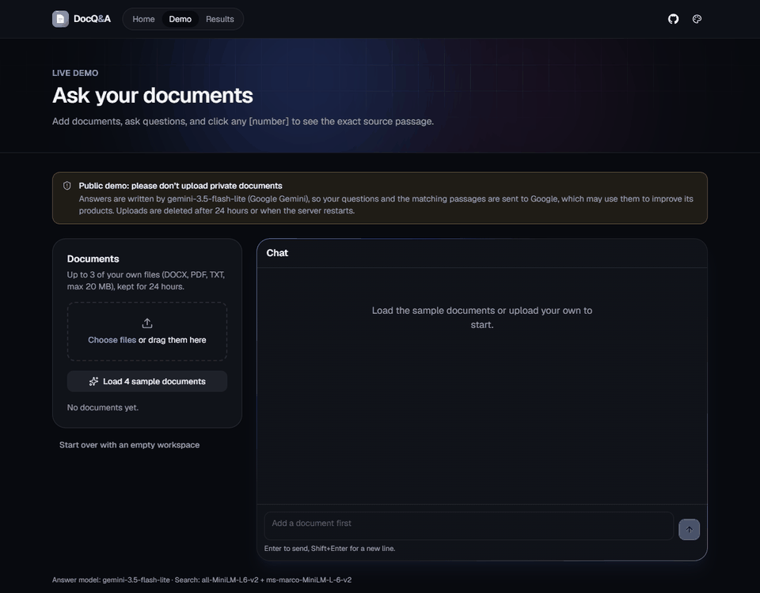
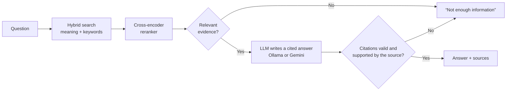

# DocQ&A

**Ask questions about your documents and get answers you can check, or an honest "I don't know".**

[](https://github.com/Md-Faiz-Alam/docqna/actions/workflows/ci.yml)


[](LICENSE)

DocQ&A is a retrieval-augmented generation (RAG) system for PDF, Word and text files. Every answer cites the exact passage it came from, and every citation is checked against the source before it is shown. When the documents don't contain the answer, it says so instead of guessing.

<!-- Live demo: add the link here once the site is deployed, e.g.
**[Try the live demo →](https://your-site.vercel.app)**
-->

<!-- Demo GIF: record a 5–10 s clip (upload → ask → streamed answer → click a citation),
save it as docs/images/demo.gif, then replace this comment with:
<p align="center"></p>
-->

## Results

Measured on a public 75-question benchmark (59 answerable, 16 deliberately unanswerable). The made-up-answer row also includes 12 unanswerable questions from a private set, and the attack row uses a separate 20-attack test:

| | Local `phi3:mini` | Gemini |
|---|---:|---:|
| Right passage in the top 5 | 100% | 100% |
| Answerable questions answered correctly | 69.5% | **98.3%** |
| Made-up answers to unanswerable questions | **0 of 28** | **0 of 28** |
| Prompt-injection attacks that reached the user | **0 of 20** | **0 of 20** |
| Time per answer (median) | 35 s on CPU | **1.9 s** |

These numbers come from sets the thresholds were tuned on. On 100 **unseen** SQuAD 2.0 questions the system still finds the right passage 96% of the time, but trick questions get through more often. That test, and what it found, is written up in [evaluation §18](docs/evaluation.md#18-held-out-test-on-unseen-questions-squad-20).

## How it works



1. **Find:** dense embeddings and BM25 keyword search, fused with reciprocal rank fusion, then reranked by a cross-encoder.
2. **Gate:** if the best passage is clearly off-topic, stop before calling the LLM.
3. **Write:** the LLM answers only from the retrieved passages, with numbered citations. Text in documents that tries to give the AI instructions is filtered out first.
4. **Verify:** each citation must exist, and the cited sentence must actually support the answer. Otherwise the answer is withheld.

Full design: [docs/architecture.md](docs/architecture.md).

## What makes it different

- **Every design choice was measured.** Chunking strategies, embedding models, retrieval methods, context size and the refusal thresholds were each compared experimentally, and the results are committed ([evaluation write-up](docs/evaluation.md), [experiments](experiments/)).
- **It checks its own answers.** A grounding check scores the answer against the cited sentence. On the tuned test sets this takes the small local model from 19 invented answers to none ([layer-by-layer ablation](docs/evaluation.md#15-what-each-layer-adds-ablation)).
- **It was attacked on purpose.** Twenty prompt-injection attacks, hidden in documents or typed into questions, went from 5–6 reaching the user to 0 ([attack test](docs/evaluation.md#16-prompt-injection-attack-test)).
- **The grader was checked too.** 80 answers were graded by hand and compared with the automatic grades: 89% agreement, kappa 0.64 ([grading check](docs/evaluation.md#19-grading-check-automatic-grades-against-ai-assisted-human-grades)).
- **Quality is enforced in CI.** Every push re-runs the public retrieval benchmark and fails the build if quality drops.
- **It's built as a product, not a notebook.** Streaming answers, follow-up questions, OCR for scanned PDFs, per-visitor document isolation, rate limits, upload quotas, readiness and Prometheus endpoints, and Docker images for local and cloud.

## Quick start

**Local and private (Ollama, nothing leaves your machine):**

```bash
docker compose up -d --build
```

**Website** (in a second terminal, needs Node.js 20.9+):

```bash
cd web
npm ci
cp .env.example .env.local
npm run dev
```

Open http://localhost:3000 and click **Load 4 sample documents** to try it without uploading anything.

To answer with Gemini instead, run the single cloud container with `GEMINI_API_KEY` set. Setup without Docker, configuration, the cloud container and the test commands are in [docs/running.md](docs/running.md).

## Tech stack

| Layer | Tools |
|---|---|
| Backend | Python 3.11, FastAPI, Pydantic, server-sent events |
| Retrieval | sentence-transformers (`all-MiniLM-L6-v2`), ChromaDB, BM25, RRF, cross-encoder (`ms-marco-MiniLM-L-6-v2`) |
| Generation | Ollama `phi3:mini` (local) or Google Gemini `gemini-3.5-flash-lite` |
| Ingestion | pypdf, pypdfium2 + Tesseract OCR, python-docx, SQLite registry |
| Website | Next.js, TypeScript, Tailwind CSS, shadcn/ui, Recharts |
| Quality | pytest (85% coverage), Vitest, ruff, mypy, GitHub Actions, Docker |

## Documentation

| Document | What's in it |
|---|---|
| [Roadmap](docs/roadmap.md) | Plain-language overview: what DocQ&A does, what's built, what's next |
| [Architecture](docs/architecture.md) | System design, production configuration, sessions, persistence, trade-offs |
| [Evaluation](docs/evaluation.md) | Every experiment, its numbers and what it does and doesn't prove |
| [Running](docs/running.md) | Local setup, configuration, Docker, cloud container, tests |
| [API](docs/api.md) | Endpoints, streaming format, conversation memory, CORS, rate limits |
| [Security](SECURITY.md) | Threat model and safeguards |
| [Limitations](docs/limitations.md) | What doesn't work yet, stated plainly |
| [Website](web/README.md) | The Next.js frontend |

## Known limitations

- The thresholds favour trust: some answerable questions end in "not enough information" instead (about 30% of public questions with the local model, under 2% with Gemini).
- The "0 made-up answers" result holds on the tuned test sets. On unseen trick questions, 6 of 50 still fooled Gemini.
- Sessions are anonymous browser IDs, not accounts, and rate limits are per process.
- Tables and multi-column PDF layouts are read as plain text.

More in [docs/limitations.md](docs/limitations.md).

## Repository layout

```text
src/docqna/      FastAPI backend: ingestion, retrieval, RAG pipeline, evaluation
web/             Next.js website: landing page, live demo, results
experiments/     reproducible evaluation experiments
data/evaluation/ labelled test sets and committed results
tests/           unit (run in CI), integration and experiment tests
docker/          local API and cloud Dockerfiles
docs/            architecture, evaluation, running, API, roadmap
```

## License

[MIT](LICENSE). The SQuAD 2.0 excerpts in `data/evaluation/heldout/` are from Wikipedia and stay under CC BY-SA 4.0.
