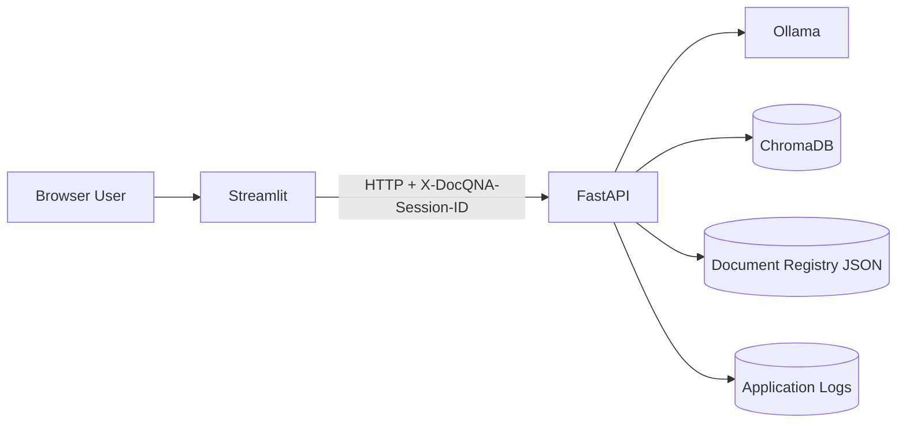
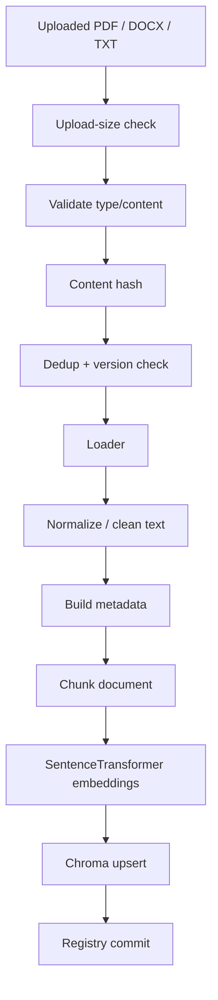
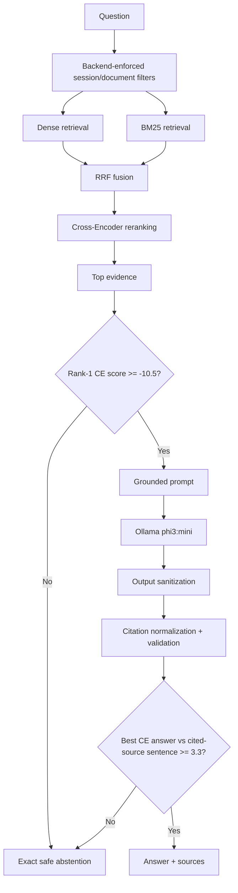
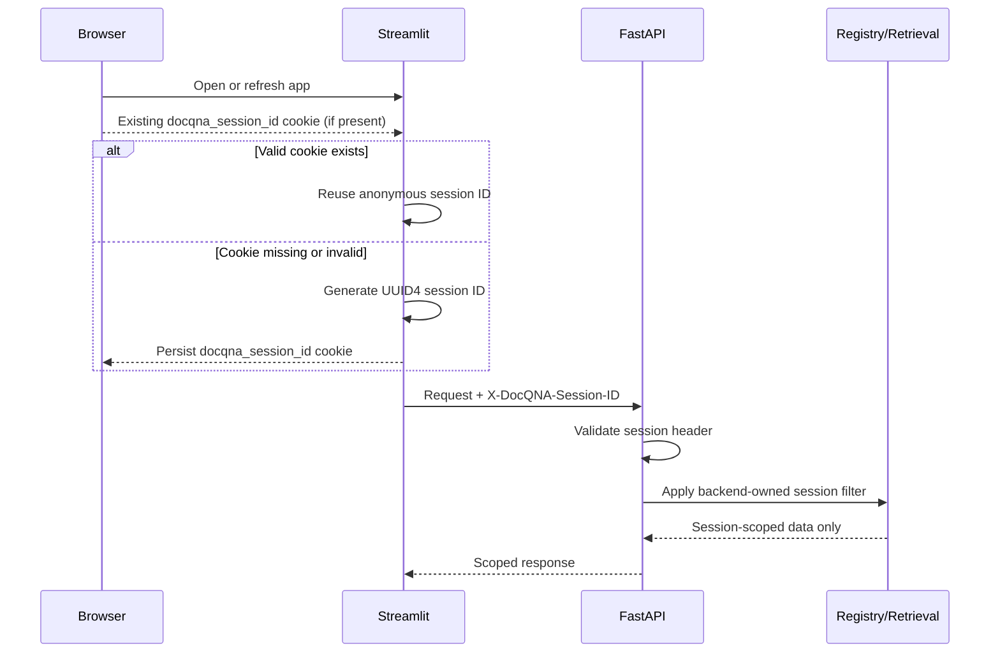
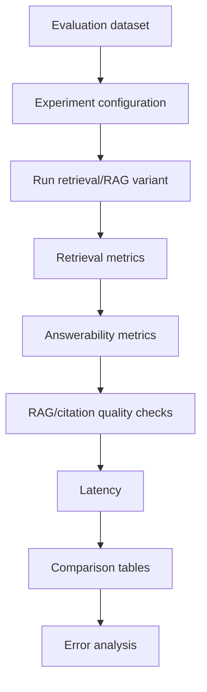
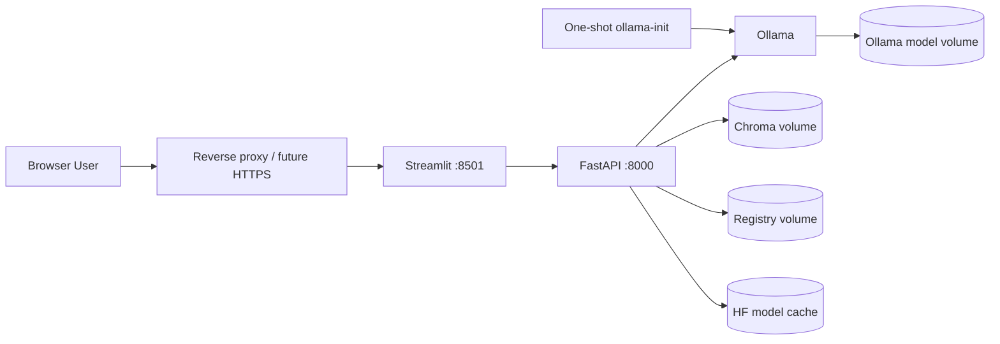

# DocQ&A Architecture

---

## 1. Purpose

DocQ&A is a document-question-answering system designed around grounded retrieval, measurable quality, operational reliability, and reproducible deployment.

The architecture separates document ingestion/indexing, online question answering, evaluation/experimentation, anonymous session isolation, persistence, observability, and container deployment.

---

## 2. System context



| Component | Responsibility |
|---|---|
| Streamlit | UI, browser-cookie-backed anonymous session identity, upload/query/document actions |
| FastAPI | API boundary, validation, session enforcement, upload-size enforcement, orchestration |
| Ingestion | parsing, validation, cleaning, metadata, chunking |
| ChromaDB | persistent dense-vector storage |
| BM25 | lexical scoring over indexed chunks |
| RRF | rank fusion across dense and lexical retrieval |
| Cross-Encoder | reranking candidate chunks |
| Answerability gate | abstain when evidence confidence is insufficient |
| Ollama | local LLM generation |
| Citation validation | normalize, repair, and verify source references |
| Registry | document identity, versioning, ownership/session scope |

---

## 3. Ingestion and indexing



Current behavior:

- uploads are capped at 20 MB by backend enforcement
- exact duplicates in the same session scope are rejected
- the same filename with changed content becomes a new version
- a new filename becomes a new logical document
- the registry is SQLite in WAL mode; duplicate/version checks and inserts run in one `BEGIN IMMEDIATE` transaction, so concurrent workers cannot lose or duplicate records (an old `documents.json` is imported once)
- indexed chunks carry document and anonymous-session metadata
- deleting a document removes its indexed representation for that session

---

## 4. Online QA pipeline



The exact abstention response is:

```text
The provided documents do not contain enough information to answer the question.
```

---

## 5. Frozen production RAG configuration

| Parameter | Value |
|---|---|
| Fixed chunk size | 200 words |
| Fixed overlap | 40 words |
| Embedding model | `sentence-transformers/all-MiniLM-L6-v2` |
| Embedding device | CPU |
| Embedding batch size | 32 |
| Vector similarity | cosine |
| Candidate pool | 10 |
| RRF constant | 60 |
| Cross-encoder | `cross-encoder/ms-marco-MiniLM-L-6-v2` |
| Reranker candidate count | 20 |
| Final top-k | 5 |
| Retrieval gate (rank-1 CE score) | -10.5 |
| Grounding check (best CE answer vs cited-source sentence) | 3.3 |
| LLM | `phi3:mini` |
| LLM temperature | 0 |
| Max generated tokens | 320 |
| Ollama timeout | 180 seconds |

These values are frozen from the project evaluation work and should change only when new evaluation evidence justifies a change.

Operational deployment controls such as the upload-size limit are separate from this frozen RAG configuration.

---

## 6. Anonymous session isolation



Isolation is enforced in registry ownership, Chroma metadata, BM25 filtering, QA retrieval, and list/delete operations.

Each session also gets its **own BM25 index**, built only from that session's chunks and kept in a bounded LRU cache (`MAX_CACHED_SESSION_INDEXES`, default 256). An upload or delete invalidates only the caller's index, and retention cleanup invalidates all of them. The models, Chroma client and RAG pipeline are built once per process and never rebuilt on document changes. Before this, any mutation in any session made the next question reload every chunk in the system.

The browser cookie preserves the anonymous namespace across normal page refreshes in the same browser. A different browser profile or incognito session receives a different namespace.

A session ID is not an account credential. This design does not provide authenticated identity, cross-device identity, or account recovery.

---

## 7. Grounding and prompt safety

Uploaded documents are treated as untrusted evidence.

The system separates application instructions, user questions, and retrieved document text. Reliability hardening includes prompt-injection-resistant grounding instructions, exact safe abstention behavior, output sanitization, citation normalization/repair, and safe fallback behavior when citation validation fails.

---

## 8. Persistence

Local runtime paths:

```text
data/indexes/        # Chroma runtime data, ignored by Git
data/metadata/       # document registry/runtime metadata, ignored by Git
logs/                # runtime logs, ignored by Git
```

Docker persistence:

| Compose volume | Container path | Purpose |
|---|---|---|
| `ollama_data` | `/root/.ollama` | Ollama model data |
| `docqna_indexes` | `/app/data/indexes` | persistent Chroma index |
| `docqna_metadata` | `/app/data/metadata` | persistent document registry |
| `huggingface_cache` | `/root/.cache/huggingface` | embedding/reranker model cache |

API-container recreation has been validated without loss of indexed document state.

Evaluation artifacts under `data/evaluation/results/` are versioned because they support architectural decisions.

---

## 9. Evaluation architecture



Evaluation is intentionally separate from the online serving path. Deployment validation does not change the frozen evaluation metrics.

---

## 10. Validated Docker topology



Container/network behavior:

- Streamlit is published only on host loopback at `127.0.0.1:8501`
- FastAPI is published only on host loopback at `127.0.0.1:8000`
- Streamlit reaches FastAPI internally at `http://api:8000`
- FastAPI reaches Ollama internally at `http://ollama:11434`
- Ollama is not published directly to the host by the Compose file
- `ollama-init` pulls `phi3:mini` into the persistent Ollama volume
- Ollama is pinned to `0.34.1`, limited to one parallel request/loaded model, and uses a bounded request queue
- API/Ollama/Streamlit containers use memory caps and Docker JSON-log rotation
- Chroma and Hugging Face telemetry are disabled in the Docker runtime
- Chroma, registry metadata, Ollama model data, and Hugging Face model downloads survive container recreation

The local Docker stack has passed end-to-end validation for service health, document upload/indexing, grounded QA with citations, exact abstention, browser-refresh session continuity, persistent Chroma/registry data, and API-container recreation.

Public cloud hosting, reverse-proxy configuration, and HTTPS are still pending.

---

## 11. Deployment validation boundary

The successful local Docker validation proves packaging, service connectivity, persistence, and the tested product flow on the development machine.

It does **not** prove:

- large-scale multi-user capacity
- reverse-proxy/HTTPS and host-firewall hardening
- production-grade backup/recovery
- request/rate-limit behavior
- long-running resource stability
- cloud-provider availability characteristics

Those concerns remain part of public deployment hardening rather than RAG architecture tuning.

---

## 12. Key trade-offs

### Hybrid retrieval

Dense retrieval captures semantic similarity while BM25 preserves exact lexical matching. RRF combines them without requiring cross-system score calibration.

### Cross-encoder reranking

The cross-encoder is applied only to a small candidate set, trading some latency for improved ranking quality.

### Explicit abstention

Retrievers always return nearest results. The answerability gate prevents weak evidence from automatically becoming an LLM answer.

### Anonymous isolation without accounts

Anonymous session namespaces keep different browser sessions separated without introducing an authentication system. The trade-off is that there is no account recovery or durable identity.

### Local-model deployment

Ollama keeps generation self-hosted and avoids an external generation API dependency, but CPU-only local inference creates a quality/latency ceiling relative to larger hosted models.

### No agent framework

The workload is a deterministic retrieval-and-answer pipeline. Additional orchestration complexity is not justified unless future requirements need multi-step tool use.

---

## 13. Failure modes

| Failure mode | Current mitigation |
|---|---|
| Oversized upload | 20 MB backend limit; request rejected |
| Duplicate upload | content hashing + scoped registry checks |
| Changed file with same name | versioning |
| Cross-session leakage | backend-enforced session filters |
| Browser refresh loses session namespace | browser-cookie-backed anonymous session ID |
| API container recreated | named volumes preserve Chroma and registry data |
| Weak evidence | CE threshold + exact abstention |
| Prompt injection in documents | untrusted-context prompting + sanitization |
| Invalid citations | normalization, repair, validation |
| Ollama unavailable | health check and typed generation errors |
| Scanned/image-only PDF | unsupported; documented limitation |
| Over-citation | known quality limitation |
| Public traffic abuse | upload/question/document/chunk limits, 24-hour cleanup, memory caps, and log rotation implemented; per-session rate limiting (429 + Retry-After) implemented in the API |
