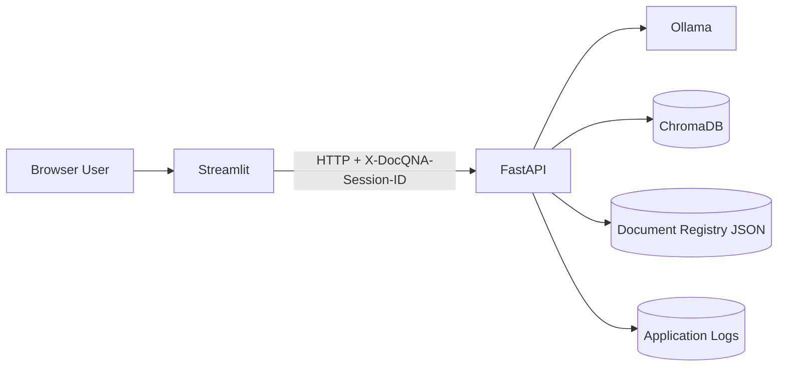
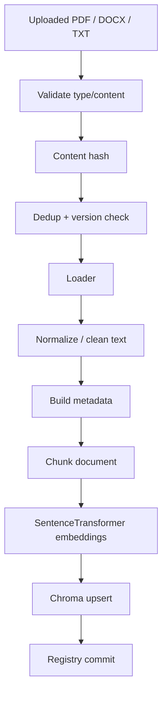
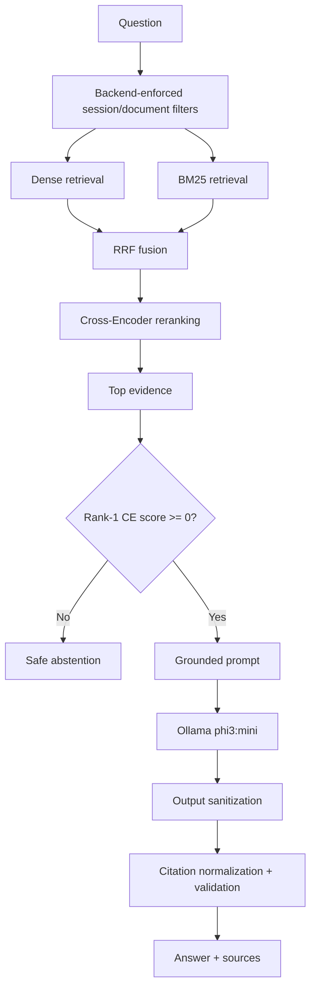
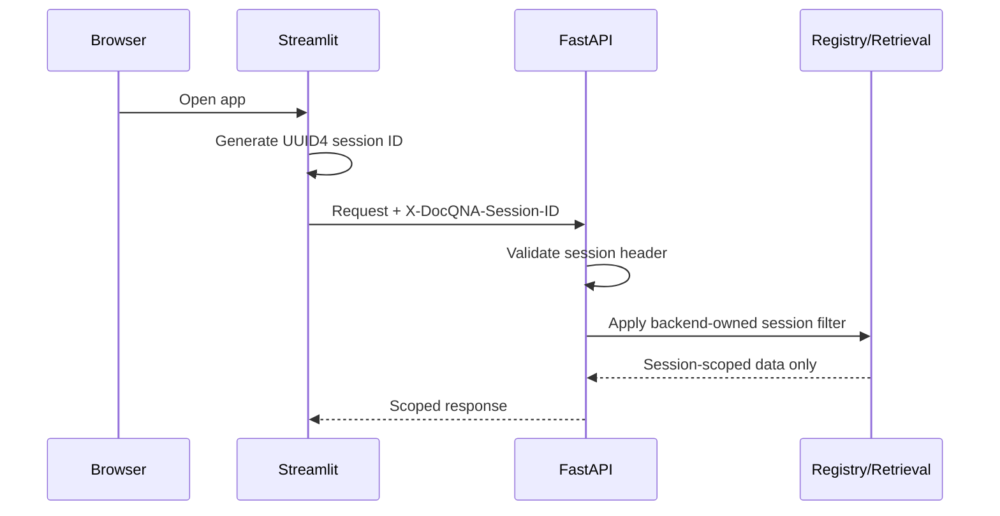
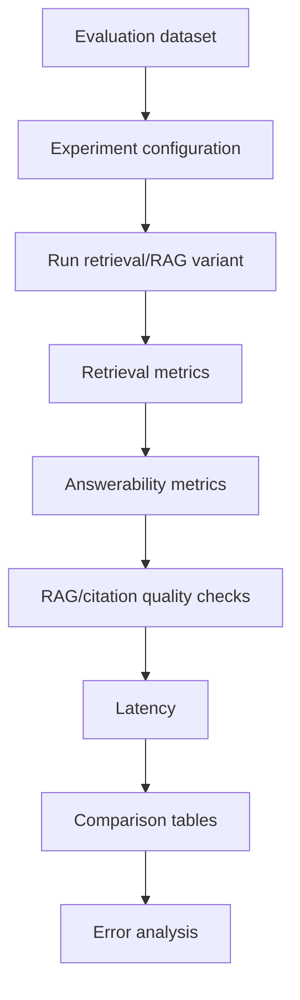
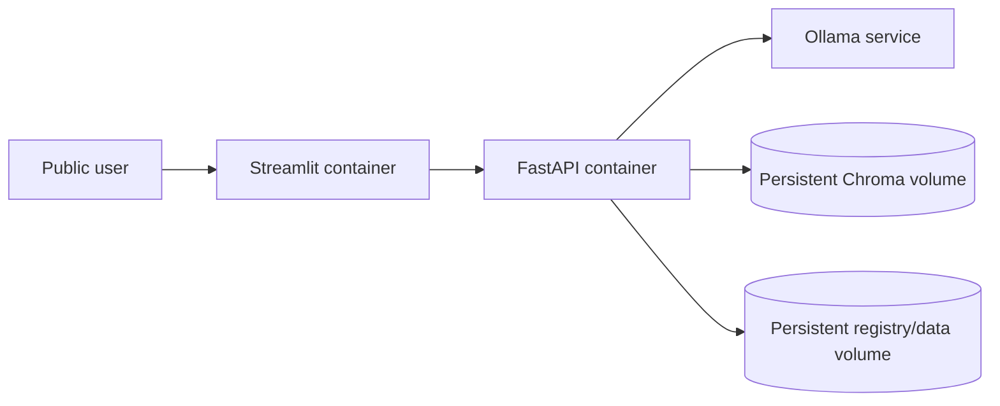

# DocQ&A Architecture

## 1. Purpose

DocQ&A is a document-question-answering system designed around grounded retrieval, measurable quality, and operational reliability.

The architecture separates document ingestion/indexing, online question answering, evaluation/experimentation, anonymous session isolation, persistence, and observability.

## 2. System context



| Component | Responsibility |
|---|---|
| Streamlit | UI, anonymous session ID generation, upload/query/document actions |
| FastAPI | API boundary, validation, session enforcement, orchestration |
| Ingestion | parsing, validation, cleaning, metadata, chunking |
| ChromaDB | persistent dense-vector storage |
| BM25 | lexical scoring over indexed chunks |
| RRF | rank fusion across dense and lexical retrieval |
| Cross-Encoder | reranking candidate chunks |
| Answerability gate | abstain when evidence confidence is insufficient |
| Ollama | LLM generation |
| Citation validation | normalize and verify source references |
| Registry | document identity, versioning, ownership/session scope |

## 3. Ingestion and indexing



Behavior:

- exact duplicate in the same session scope is rejected,
- same filename with changed content becomes a new version,
- a new filename becomes a new logical document,
- registry persistence uses atomic JSON writes,
- indexed chunks carry document and session metadata,
- deleting a document removes its indexed representation for that session.

## 4. Online QA pipeline



## 5. Frozen production configuration

| Parameter | Value |
|---|---|
| Fixed chunk size | 200 words |
| Fixed overlap | 40 words |
| Embedding model | `sentence-transformers/all-MiniLM-L6-v2` |
| Embedding device | CPU |
| Vector similarity | cosine |
| Candidate pool | 10 |
| RRF constant | 60 |
| Cross-encoder | `cross-encoder/ms-marco-MiniLM-L-6-v2` |
| Reranker candidate count | 20 |
| Final top-k | 5 |
| Answerability threshold | 0 |
| LLM | `phi3:mini` |
| LLM temperature | 0 |
| Max generated tokens | 320 |
| Ollama timeout | 180 seconds |

These values are frozen from the project evaluation work and should only change with new evaluation evidence.

## 6. Anonymous session isolation



Isolation is enforced in registry ownership, Chroma metadata, BM25 filtering, QA retrieval, and list/delete operations.

A session ID is not an account credential. This design does not provide authenticated identity or account recovery.

## 7. Grounding and prompt safety

Uploaded documents are treated as untrusted evidence.

The system separates application instructions, user questions, and retrieved document text. Reliability hardening includes prompt-injection-resistant grounding instructions, exact safe abstention behavior, output sanitization, citation normalization/repair, and safe fallback behavior when citation validation fails.

## 8. Persistence

```text
data/indexes/        # local Chroma runtime data (ignored by Git)
data/metadata/       # document registry/runtime metadata (ignored by Git)
logs/                # runtime logs (ignored by Git)
```

Evaluation artifacts under `data/evaluation/results/` are versioned because they support architectural decisions.

## 9. Evaluation architecture



## 10. Deployment target

Planned Phase 23 topology:



This is the target deployment design. Docker support should only be claimed after end-to-end validation.

## 11. Key trade-offs

### Hybrid retrieval

Dense retrieval captures semantic similarity while BM25 preserves exact lexical matching. RRF combines them without requiring cross-system score calibration.

### Cross-encoder reranking

The cross-encoder is applied only to a small candidate set, trading some latency for improved ranking quality.

### Explicit abstention

Retrievers always return nearest results. The answerability gate prevents weak evidence from automatically becoming an LLM answer.

### No agent framework

The workload is a deterministic retrieval-and-answer pipeline. Additional orchestration complexity is not justified unless future requirements need multi-step tool use.

## 12. Failure modes

| Failure mode | Current mitigation |
|---|---|
| Duplicate upload | content hashing + scoped registry checks |
| Changed file with same name | versioning |
| Cross-session leakage | backend-enforced session filters |
| Weak evidence | CE threshold + abstention |
| Prompt injection in documents | untrusted-context prompting + sanitization |
| Invalid citations | normalization, repair, validation |
| Ollama unavailable | health check and typed generation errors |
| Scanned PDF | unsupported; documented limitation |
| Over-citation | known quality limitation |
